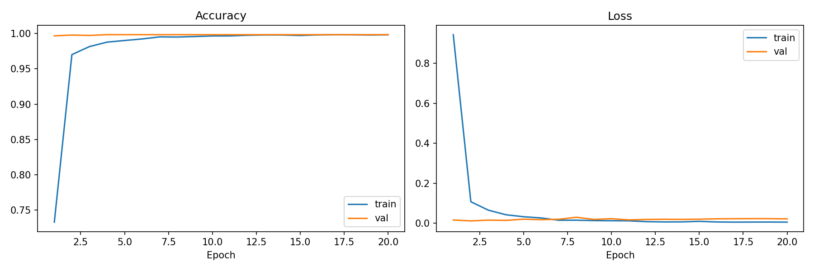
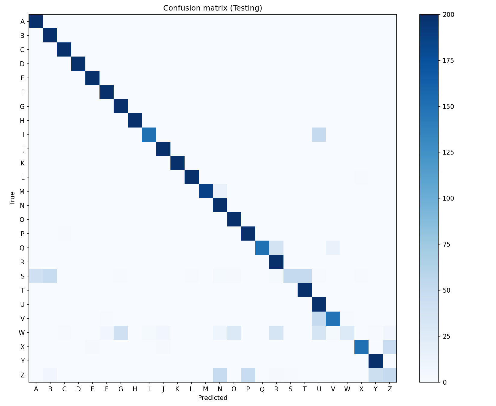

# Indian Sign Language Interpreter

A CNN-based fingerspelling **letter** recognizer for Indian Sign Language. It classifies a
hand-sign image into one of 26 letters (A–Z) and can run from a webcam or a browser.
This is letter recognition — it does **not** translate sentences or sequences.

The model, dataset and Docker artifacts are not committed (they are large / environment
specific). All reported numbers come from files in `results/` and `splits/`.

## Problem

People who are deaf and hard-of-hearing use fingerspelling to spell words letter by letter.
A camera system that recognises static ISL fingerspelling letters can help bridge
communication with people who do not know sign language. This project trains and serves a
small CNN that maps a 128×128 grayscale image of a hand sign to one of 26 letters.

## Dataset

One folder per letter under `Training/`, `Validation/` and `Testing/`. The class list lives in
`labels.json` and is the single source of truth for training, evaluation, the webcam script
and the API.

| Split | Images (folders) | Classes | Images used in evaluation |
|---|---|---|---|
| Training | 18,198 | 26 (A–Z) | — (not evaluated; 10% used for in-training validation) |
| Validation | 2,579 | 26 (A–Z) | 2,579 |
| Testing | 5,200 | 26 (A–Z) | 5,198 (2 unreadable) |

Images are resized to 128×128 grayscale and scaled to [0, 1]. A small number of files are
corrupt and are skipped (for example `Testing/E/301.jpg`). Duplicate analysis is in
`results/duplicate_report.json`.

## Architecture

A small sequential CNN (unchanged from the original design):

- Conv2D(64, 3×3) → ReLU → MaxPool
- Conv2D(64, 3×3) → ReLU → MaxPool
- Conv2D(128, 3×3) → ReLU → MaxPool
- Flatten → Dense(256) → ReLU → Dropout(0.5)
- Dense(128) → ReLU → Dropout(0.5)
- Dense(26) → Softmax

Adam, sparse categorical cross-entropy, `ReduceLROnPlateau`, 20 epochs, batch size 32,
seed 42. Final model: **6,570,458 parameters, 75.26 MB**, input `(128, 128, 1)`, output
`(None, 26)` (see `results/environment.txt`).



## Quickstart

```powershell
py -3.12 -m venv .venv
.\.venv\Scripts\Activate.ps1
python -m pip install --upgrade pip
pip install -r requirements.txt
```

Train (writes the model plus `results/history.json` and `results/training_curves.png`):

```powershell
python model.py --data-dir Training --labels labels.json --output ISL_Interpreter.keras --epochs 20
```

Evaluate the saved model on the held-out folders:

```powershell
python evaluate.py --model-path ISL_Interpreter.keras --labels labels.json
python evaluate.py --model-path ISL_Interpreter.keras --labels labels.json --exclude-duplicates splits/clean_test.txt --output results/metrics_clean.json
```

Run the webcam app, the browser app, or the audits:

```powershell
python ISL_Interpreter.py --model-path ISL_Interpreter.keras --labels labels.json
uvicorn web_app:app --host 0.0.0.0 --port 8000
python scripts/audit_duplicates.py --root .
python scripts/benchmark_model.py --output results/model_latency.txt
python scripts/benchmark_api.py --base-url http://127.0.0.1:8000 --output results/api_latency.txt
python scripts/env_info.py --output results/environment.txt
```

Docker (the trained model is not baked into the image; mount or copy it in):

```powershell
docker build -t isl-interpreter .
docker run --rm -p 8000:8000 isl-interpreter
```

## Results

All figures are from `results/metrics.json` and `results/metrics_clean.json` (seed 42, model
loaded from `ISL_Interpreter.keras`). The training-time `val_accuracy` (an in-memory 10%
slice of `Training/`) reached 0.9984 — far above the folder-based evaluation below, because
the provided `Validation/` and `Testing/` folders come from a different distribution.

| Split | Images | Accuracy | Macro-F1 |
|---|---|---|---|
| Testing (full) | 5,198 | 0.8671 | 0.8454 |
| **Testing (duplicate-free)** | 4,587 | **0.8494** | **0.8232** |
| Validation | 2,579 | 0.7980 | 0.7727 |



Per-class precision/recall/F1 for every letter is in `results/metrics_clean.json`. The
weakest classes are **W** (F1 0.24), **Z** (F1 0.00 on the clean/validation sets) and **S**
(F1 0.40); most letters score above 0.95.

## Latency

CPU inference on **AMD Ryzen (AMD64 Family 23 Model 96, 12 logical cores, 15.37 GB RAM),
Windows 11, Python 3.12.10** (see `results/environment.txt`).

| Measurement | Median | p95 | Throughput | Source |
|---|---|---|---|---|
| Model only (in-process) | 65.59 ms | 67.45 ms | 15.22 FPS | `results/model_latency.txt` |
| End-to-end (preprocess + predict) | 66.01 ms | 68.17 ms | 15.10 FPS | `results/model_latency.txt` |
| FastAPI `POST /predict` (HTTP) | 80.53 ms | 97.71 ms | 12.21 req/s | `results/api_latency.txt` |

GPU inference: [NOT MEASURED] — the installed TensorFlow build is CPU-only, so the available
GTX 1650 could not be used.

## Limitations

- **The provided splits leak.** Hashing every image (SHA-256) shows 611 of 5,200 Testing
  images are **byte-identical to a Training image** (plus 99 Training↔Validation and 52
  Validation↔Testing). Training data was left untouched; the duplicates were removed from
  testing only, via `splits/clean_test.txt`, and the duplicate-free number (0.8494) is the
  honest headline. Dropping duplicates costs ~1.8 accuracy points.
- **Near-duplicates remain even in the "clean" set.** Using pHash (64-bit, Hamming ≤ 5),
  4,053 of 5,198 Testing images and 1,791 of 2,579 Validation images are perceptually close
  to a Training image. Some of these are genuinely different photos of the same letter and
  pose, so the split is not clean by signer or session.
- **No signer or session identifiers.** Filenames are plain numeric indices, so a group
  split (`GroupShuffleSplit`) is impossible from this data.
- **The evaluation folders are much harder than training.** In-training validation reached
  0.9984 while the `Validation/` folder scores 0.7980, indicating a domain gap (background,
  signer or capture differences) rather than a well-generalising model.
- **Single provided dataset, controlled setting.** No evidence of performance on new
  signers, varied lighting or cluttered backgrounds. Live-webcam accuracy is [NOT MEASURED].
- Not sentence- or sequence-level recognition; static single-letter images only.

## Credits

Original CNN training and webcam code by the repository owner(sohansourab). Evaluation, duplicate audit,
API benchmark and environment tooling added in this repository. Built with TensorFlow/Keras,
OpenCV, scikit-learn, FastAPI, Uvicorn and Docker.
